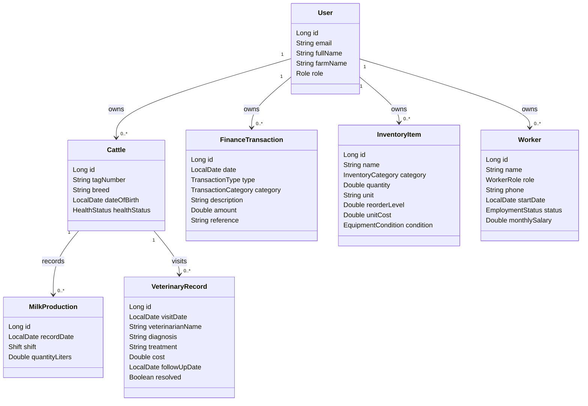

# Dairy Farm Management REST API

A Spring Boot REST API implementing full CRUD for six farm-data entities - **Cattle**,
**Milk Production**, **Veterinary Record**, **Finance Transaction**, **Inventory
Item**, and **Worker** - behind JWT authentication, with every record scoped to the
account that owns it. It extends the original
[DairyFarmManagementSystem](./DairyFarmManagementSystem) (JSF + Hibernate) proposal by
re-implementing Cattle and Milk Production as a REST API and adding Veterinary Record,
Finance, Inventory and Workers - the areas explicitly left out of that project's
initial scope.

## Abstract

Dairy farms need accurate, centralized cattle, production and health records to make
daily decisions. This API exposes create, read, update and delete operations for
cattle registration, milk production logging, and veterinary visit tracking, with
server-side validation and cross-entity business rules enforced in the service layer.

## Scope

- **Cattle**: registration and lifecycle (health status) tracking.
- **Milk Production**: per-shift production records linked to a cattle.
- **Veterinary Record**: health visits linked to a cattle, with a resolve workflow
  that updates the cattle's health status.
- **Finance Transaction**: income/expense ledger entries.
- **Inventory Item**: feed, supplies and equipment stock tracking.
- **Worker**: farm staff records and monthly wages.
- **Authentication**: JWT-based registration, login (with email OTP as a second
  factor), email verification, and password reset - see
  [Authentication](#authentication) below.

Every one of the six farm-data entities is scoped to the authenticated account
(see [Multi-tenancy](#multi-tenancy)) - there is no cross-farm visibility.
Payments processing and reporting dashboards are outside scope.

## Entity Relationship



Every entity other than `User` itself extends a shared `OwnedEntity` base (an
`owner_id` foreign key to `User`), which is what makes the per-account isolation in
[Multi-tenancy](#multi-tenancy) possible without repeating the column six times.

## Business Requirements

| ID | Rule |
|---|---|
| BR-01 | Every cattle has a tag number unique to its owner (not globally - two different farms may each use "001"), plus breed, date of birth and health status. |
| BR-02 | Cattle date of birth cannot be in the future. |
| BR-03 | Every milk production and veterinary record must reference an existing cattle **owned by the same account**. |
| BR-04 | Milk production stores a date, shift (MORNING/EVENING) and litres produced. |
| BR-05 | Full CRUD is available for Cattle. |
| BR-06 | Full CRUD is available for Milk Production. |
| BR-07 | Tag numbers must be 3-20 letters/digits/hyphens; quantity must be 0-100 litres. |
| BR-08 | Failed operations roll back and return a structured, user-facing JSON error (no stack traces leak). |
| BR-09 | A cattle can have at most one milk production record per shift per day. |
| BR-10 | Veterinary visit date cannot be future, cost cannot be negative, and a follow-up date (if given) must be after the visit date. |
| BR-11 | Creating a veterinary record moves the cattle to `UNDER_TREATMENT`; resolving the record (`PATCH /veterinary-records/{id}/resolve`) moves it to `RECOVERED`. |
| BR-12 | A cattle marked `DECEASED` cannot receive new milk production or veterinary records. |
| BR-13 | Finance transaction date cannot be in the future; amount must be positive. |
| BR-14 | Inventory item quantity, reorder level and unit cost cannot be negative. |
| BR-15 | Worker start date cannot be in the future; monthly salary cannot be negative. |
| BR-16 | Every record (Cattle, Milk Production, Veterinary Record, Finance, Inventory, Worker) is scoped to the authenticated account; looking up another account's record by ID returns 404, same as if it didn't exist. |

## Technology Stack

| Item | Detail |
|---|---|
| Language | Java 21 |
| Framework | Spring Boot 4.1.1 (Spring Web, Spring Data JPA, Bean Validation, Spring Security, Spring Mail) |
| Auth | Stateless JWT (HS256, `io.jsonwebtoken`), BCrypt password hashing, email OTP |
| Database | PostgreSQL 16 (default) or H2 (`h2` profile) |
| Build | Maven |
| Testing | Postman / Newman collection (see below) |

## Architecture

```text
Client (Postman / browser) -> REST Controllers -> Services (business rules) -> Spring Data Repositories -> Database
```

Each entity follows the same package layout:

```text
src/main/java/com/innovation/dairyfarm/<entity>/
  domain/      JPA entity (+ enums)
  repository/  Spring Data JPA repository
  dto/         Request/response records with Bean Validation
  service/     Interface + implementation holding business rules
  controller/  REST endpoints
```

Cross-cutting concerns (`BaseEntity`, custom exceptions, `GlobalExceptionHandler`)
live under `com.innovation.dairyfarm.common`. JWT issuing/validation, the
`Authorization` header filter, and the Spring Security + CORS configuration
live under `com.innovation.dairyfarm.security` and apply to every entity
package above - all `/api/**` routes other than `/api/auth/**` require a
valid bearer token.

## Running the API

### Required environment variables

The app needs a JWT signing secret and SMTP credentials before it will start
and send OTP emails. Copy `.env.example` to `.env` (git-ignored) in this
folder and fill it in, or export the same variables in your shell:

| Variable | Required | Notes |
|---|---|---|
| `JWT_SECRET` | Yes | 32+ byte random string, e.g. `openssl rand -base64 32`. No default - the app fails fast without it. |
| `MAIL_USERNAME` | Yes | The sending email address. |
| `MAIL_PASSWORD` | Yes | For Gmail, a 16-character **App Password** (myaccount.google.com/apppasswords, requires 2-Step Verification) - not the normal account password. |
| `MAIL_FROM` | No | Defaults to `MAIL_USERNAME`. |
| `JWT_EXPIRATION_MS` | No | Access token lifetime, default 24h. |
| `OTP_EXPIRATION_MINUTES` | No | Default 10. |
| `OTP_RESEND_COOLDOWN_SECONDS` | No | Default 30. |
| `PASSWORD_RESET_EXPIRATION_MINUTES` | No | Default 15. |
| `CORS_ALLOWED_ORIGINS` | No | Comma-separated frontend origins, default `http://localhost:3000`. |

### Default (PostgreSQL)

```bash
docker compose up -d postgres
mvn spring-boot:run
```

The API starts on `http://localhost:8080` and connects to PostgreSQL at
`localhost:5432`, using database `dairy_farm_db`. Compose stores database files
in a named volume. Set `DB_URL`, `DB_USERNAME`, and `DB_PASSWORD` to override
the connection settings.

To stop PostgreSQL while preserving data, run `docker compose down`. To remove
the database volume as well, run `docker compose down -v`.

### Optional H2 profile

```bash
mvn spring-boot:run -Dspring-boot.run.profiles=h2
```

This profile persists to `./data/dairyfarmdb`; its console is available at
`/h2-console`.

### Legacy PostgreSQL profile

The `postgres` profile remains available for compatibility. PostgreSQL is now
the default, so it does not need to be activated.

> **Windows note:** if you need a fully clean rebuild, delete the `target/`
> directory manually (`rm -rf target` or `Remove-Item -Recurse -Force target`)
> before `mvn package` rather than running `mvn clean package` — on this project
> the `clean` goal was observed to race with file writes under a
> Desktop-synced folder and produce an empty jar. A plain `mvn package` after
> a manual delete works reliably.

### PostgreSQL profile (matches the original JSF project's database)

```bash
mvn spring-boot:run -Dspring-boot.run.profiles=postgres
```

Set `DB_URL`, `DB_USERNAME`, `DB_PASSWORD` environment variables beforehand, or
rely on the defaults in `application-postgres.properties`
(`jdbc:postgresql://localhost:5432/dairy_farm_db`).

### Building a jar

```bash
mvn -DskipTests package
java -jar target/dairyfarm-api-0.0.1-SNAPSHOT.jar
```

## Authentication

Every route lives under `/api/auth` and is publicly accessible; everything
else under `/api/**` requires `Authorization: Bearer <token>`.

| Method | Path | Purpose |
|---|---|---|
| POST | `/api/auth/register` | Create an account (unverified) and email a signup OTP. |
| POST | `/api/auth/login` | Check credentials; on success, email a 2FA OTP (does **not** return a token yet). |
| POST | `/api/auth/otp/verify` | Verify a 6-digit code. Body: `{email, code, purpose}` where `purpose` is `SIGNUP_VERIFICATION`, `LOGIN_2FA`, or `PASSWORD_RESET`. Returns `{token, user}` for the first two; returns `{resetToken}` for `PASSWORD_RESET`. |
| POST | `/api/auth/otp/resend` | Re-send a code for `{email, purpose}` (throttled). |
| POST | `/api/auth/password/forgot` | Request a `PASSWORD_RESET` OTP for `{email}`. Always responds the same way, whether or not the email is registered. |
| POST | `/api/auth/password/reset` | Exchange `{resetToken, newPassword}` (from the OTP-verify step) for a new password. |
| GET | `/api/auth/me` | Current authenticated user (requires a bearer token). |

Flow: `register` -> email `SIGNUP_VERIFICATION` code -> `otp/verify` -> signed
in. `login` -> email `LOGIN_2FA` code -> `otp/verify` -> signed in. Forgot
password: `password/forgot` -> email `PASSWORD_RESET` code -> `otp/verify`
(returns `resetToken`) -> `password/reset`.

Security notes:
- Passwords and OTP codes are hashed (BCrypt) before being stored - never in plaintext.
- `password/forgot` never reveals whether an email is registered; it only
  actually sends mail when the account exists, but the HTTP response is
  identical either way.
- CORS only allows the origins listed in `CORS_ALLOWED_ORIGINS` (not `*`),
  since `Authorization` header support requires `allowCredentials(true)`,
  and the CORS spec disallows pairing that with a wildcard origin.
- `register`/`login`/OTP flows are each one `@Transactional` unit - if the
  email fails to send, the whole operation (including the DB write) rolls
  back, so you never end up with a user that has no way to verify.

## API Endpoints

| Entity | Method | Path | Purpose |
|---|---|---|---|
| Cattle | POST | `/api/cattle` | Create |
| Cattle | GET | `/api/cattle` | List all |
| Cattle | GET | `/api/cattle/{id}` | Get one |
| Cattle | PUT | `/api/cattle/{id}` | Update |
| Cattle | DELETE | `/api/cattle/{id}` | Delete |
| Milk Production | POST | `/api/milk-productions` | Create |
| Milk Production | GET | `/api/milk-productions?cattleId=` | List all / by cattle |
| Milk Production | GET | `/api/milk-productions/{id}` | Get one |
| Milk Production | PUT | `/api/milk-productions/{id}` | Update |
| Milk Production | DELETE | `/api/milk-productions/{id}` | Delete |
| Veterinary Record | POST | `/api/veterinary-records` | Create |
| Veterinary Record | GET | `/api/veterinary-records?cattleId=` | List all / by cattle |
| Veterinary Record | GET | `/api/veterinary-records/{id}` | Get one |
| Veterinary Record | PUT | `/api/veterinary-records/{id}` | Update |
| Veterinary Record | PATCH | `/api/veterinary-records/{id}/resolve` | Resolve (BR-11) |
| Veterinary Record | DELETE | `/api/veterinary-records/{id}` | Delete |
| Finance Transaction | POST | `/api/finance-transactions` | Create |
| Finance Transaction | GET | `/api/finance-transactions` | List all |
| Finance Transaction | GET | `/api/finance-transactions/{id}` | Get one |
| Finance Transaction | PUT | `/api/finance-transactions/{id}` | Update |
| Finance Transaction | DELETE | `/api/finance-transactions/{id}` | Delete |
| Inventory Item | POST | `/api/inventory-items` | Create |
| Inventory Item | GET | `/api/inventory-items` | List all |
| Inventory Item | GET | `/api/inventory-items/{id}` | Get one |
| Inventory Item | PUT | `/api/inventory-items/{id}` | Update |
| Inventory Item | DELETE | `/api/inventory-items/{id}` | Delete |
| Worker | POST | `/api/workers` | Create |
| Worker | GET | `/api/workers` | List all |
| Worker | GET | `/api/workers/{id}` | Get one |
| Worker | PUT | `/api/workers/{id}` | Update |
| Worker | DELETE | `/api/workers/{id}` | Delete |

All of the above require `Authorization: Bearer <token>` and only ever
operate on the caller's own records - see [Multi-tenancy](#multi-tenancy).

Validation and business-rule failures return a structured error body:

```json
{
  "timestamp": "2026-09-20T00:23:30.505",
  "status": 400,
  "error": "Validation Failed",
  "message": "One or more fields are invalid.",
  "details": ["tagNumber: tagNumber must be 3-20 letters, digits or hyphens"]
}
```

## Testing via Postman

A ready-to-run collection and environment are in [`postman/`](./postman):

- `DairyFarmAPI.postman_collection.json` — full CRUD requests for all three
  entities plus dedicated negative-test requests for every business rule
  (BR-01, BR-02, BR-07, BR-09, BR-10, BR-11, BR-12), organized as
  Cattle → Milk Production → Veterinary Records → Deceased Cattle Guard → Cleanup.
- `DairyFarmAPI.postman_environment.json` — `baseUrl` plus chained id variables
  (`cattleId`, `milkProductionId`, `veterinaryRecordId`) that requests set and
  reuse automatically via test scripts.

**Import both files into Postman**, select the "Dairy Farm API - Local"
environment, start the API (`mvn spring-boot:run`), and run the collection
(Collection Runner, or per-folder). Every request carries a `pm.test` assertion
on status code (and on key response fields for the business-rule flows), so a
full pass/fail summary is produced automatically.

The same collection was verified headlessly with [Newman](https://github.com/postmanlabs/newman):

```bash
npx newman run postman/DairyFarmAPI.postman_collection.json \
  -e postman/DairyFarmAPI.postman_environment.json
```

Last verified run: **33 requests / 34 assertions, 0 failures.**

> **Note:** this collection predates JWT auth and the three new entities. Every
> request in it now needs an `Authorization: Bearer <token>` header (obtained via
> the [Authentication](#authentication) flow) before it will pass again, and
> there's no coverage yet for Finance, Inventory or Workers. Treat it as due for
> a refresh rather than as current proof of behavior.

## CRUD Implementation Matrix

| Entity | Create | Read | Update | Delete |
|---|---|---|---|---|
| Cattle | `POST /api/cattle` | `GET /api/cattle`, `GET /api/cattle/{id}` | `PUT /api/cattle/{id}` | `DELETE /api/cattle/{id}` |
| Milk Production | `POST /api/milk-productions` | `GET /api/milk-productions`, `GET /api/milk-productions/{id}` | `PUT /api/milk-productions/{id}` | `DELETE /api/milk-productions/{id}` |
| Veterinary Record | `POST /api/veterinary-records` | `GET /api/veterinary-records`, `GET /api/veterinary-records/{id}` | `PUT /api/veterinary-records/{id}` | `DELETE /api/veterinary-records/{id}` |
| Finance Transaction | `POST /api/finance-transactions` | `GET /api/finance-transactions`, `GET /api/finance-transactions/{id}` | `PUT /api/finance-transactions/{id}` | `DELETE /api/finance-transactions/{id}` |
| Inventory Item | `POST /api/inventory-items` | `GET /api/inventory-items`, `GET /api/inventory-items/{id}` | `PUT /api/inventory-items/{id}` | `DELETE /api/inventory-items/{id}` |
| Worker | `POST /api/workers` | `GET /api/workers`, `GET /api/workers/{id}` | `PUT /api/workers/{id}` | `DELETE /api/workers/{id}` |

## Multi-tenancy

Every farm-data entity (Cattle, Milk Production, Veterinary Record, Finance
Transaction, Inventory Item, Worker) extends a shared `OwnedEntity` base
(`com.innovation.dairyfarm.common.OwnedEntity`) that adds an `owner_id` foreign
key to `User`. Each repository exposes owner-scoped finders
(`findAllByOwnerId`, `findByIdAndOwnerId`, ...) and every service method takes
the caller's id (or full `User`, when creating) pulled from the JWT via
`com.innovation.dairyfarm.security.CurrentUser` - controllers never trust a
client-supplied owner.

Two consequences worth knowing:
- Looking up another account's record by ID returns a plain 404, identical to
  a record that doesn't exist at all - it never leaks that the ID belongs to
  someone else.
- Cattle tag-number uniqueness (BR-01) is enforced **per owner**, both at the
  service layer and with a composite DB unique constraint on
  `(tag_number, owner_id)` - two different farms can both register a "001".

## Links

- GitHub source code: **TO BE REPLACED WITH THE PUBLIC GITHUB REPOSITORY LINK**
- Google Vids project walkthrough (5-10 minutes, screen + camera): **TO BE REPLACED WITH THE GOOGLE VIDS SHARE LINK**

## Video Recording Plan

| Time | Content |
|---|---|
| 0:00-0:45 | Problem, objective, and why Veterinary Record extends the original scope |
| 0:45-1:30 | Entities and relationships (Cattle, Milk Production, Veterinary Record) |
| 1:30-2:15 | Architecture: controller -> service -> repository, validation and error handling |
| 2:15-3:30 | Cattle CRUD demonstration in Postman |
| 3:30-4:45 | Milk Production CRUD + duplicate-shift and range validation demo |
| 4:45-6:15 | Veterinary Record CRUD + resolve workflow (UNDER_TREATMENT -> RECOVERED) |
| 6:15-7:00 | Deceased-cattle guard rule (BR-12) demonstration |
| 7:00-7:30 | Wrap-up: Postman collection, GitHub repo, conclusion |

## Submission Checklist

- [ ] Replace the GitHub placeholder above with the public repository URL.
- [ ] Push the source code, this README, and the `postman/` collection to GitHub.
- [ ] Record the workflow using Google Vids with screen and camera enabled (5-10 min).
- [ ] Set sharing permission so the assessor can open the video.
- [ ] Replace the Google Vids placeholder above with the share URL.
- [ ] Confirm the jar builds with `mvn -DskipTests package` and runs with `java -jar target/dairyfarm-api-0.0.1-SNAPSHOT.jar`.
