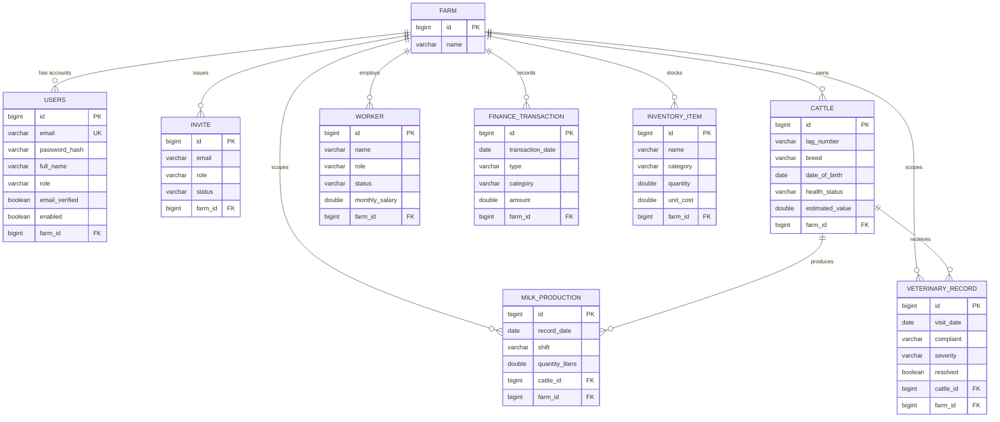

# FarmIQ — Mid-Term Project Report

**Course:** INSY 8322 — Web Technologies (AUCA)
**Project:** FarmIQ (MooFlow) — Dairy & Livestock Farm Management System

---

## 1. Problem Statement

Small and mid-sized dairy farms in Rwanda keep records of their herd, milk yield, veterinary visits, finances, and workers across paper logbooks, personal notebooks, or scattered spreadsheets. This creates several concrete problems:

- **No single source of truth.** A farm owner cannot see herd health, milk production trends, and cash flow together, so decisions (e.g., whether to sell an animal, restock feed, or hire a worker) are made on incomplete information.
- **No shared access.** When an owner hires workers or opens a second location (branch), there is no controlled way to let them view or update farm data without handing over full access to everything, including finances.
- **No historical traceability.** Paper records make it hard to answer questions like "has this cow's milk yield been dropping for the last two weeks?" or "how much did we spend on veterinary care this quarter?"
- **No accountability trail.** There is no reliable record of who changed what, which matters once more than one person (owner, workers, branch accounts) touches the same data.

**FarmIQ** addresses this by providing a web application where a farm's herd, production, health, financial, inventory, and staffing records live in one place, scoped to that farm, with role-based access for the people who work there.

## 2. Target Users

| Role | Description | Typical Goals |
|---|---|---|
| **Farm Owner** (`FARM_OWNER`) | Registers the farm and owns the account. | Full visibility: herd, production, health, **finance**, inventory, **workers**, and the ability to invite/revoke accounts. |
| **Worker** (`WORKER`) | Invited by the owner to help run day-to-day operations. | Record milk yield, log veterinary visits, manage inventory and cattle records. Finance and Workers sections are hidden from this role. |
| **Branch** (`BRANCH`) | Invited by the owner to represent another physical location of the same farm business. | Same visibility as a Worker; exists so a multi-site operation can be modeled under one farm without merging unrelated farms' data. |

All three roles belong to exactly one `Farm` — this is the tenancy boundary that keeps one farm's data invisible to another.

## 3. Objectives and Scope

**Objectives**

1. Let a farm owner register an account and have a `Farm` created for them automatically.
2. Let the owner invite workers/branches by email, and let invited people join via a one-time invite link without the owner ever sharing a password.
3. Track cattle individually (tag number, breed, health status, value, lifecycle events) scoped to the inviting farm.
4. Record daily milk production per animal per shift and surface trends.
5. Record veterinary visits and automatically reflect them in the animal's health status.
6. Track income/expense transactions and summarize them (visible to the owner only).
7. Track consumable and equipment inventory with reorder visibility.
8. Track worker HR records (distinct from login accounts) — role, employment status, salary (visible to the owner only).

**In scope (mid-term):** the items above, built as a Next.js frontend + Spring Boot/PostgreSQL REST backend with JWT authentication, role-based route guards, and farm-scoped multi-tenancy.

**Explicitly out of scope (for now):** a non-relational database — this final-term rubric item has not been started and is deliberately deferred rather than bolted on prematurely. RabbitMQ-based async messaging and OAuth2 (Google) login, both also final-term items, have since been implemented (see §4.1 and §9).

## 4. Functional & Business Requirements

### 4.1 Functional Requirements (by module)

| Module | Endpoint base | Operations |
|---|---|---|
| Auth | `/api/auth` | register, join-by-invite, login, OTP verify/resend, forgot/reset password, get/update profile, change password, delete account |
| Farm | `/api/farm` | list all user accounts belonging to the caller's farm |
| Invite | `/api/invites` | list invites, public lookup by id (drives the join page), create, revoke |
| Cattle | `/api/cattle` | create, list, get by id, update, delete |
| Milk Production | `/api/milk-productions` | create, list, get by id, update, delete |
| Veterinary Record | `/api/veterinary-records` | create, list, get by id, update, **resolve** (`PATCH /{id}/resolve`), delete |
| Finance Transaction | `/api/finance-transactions` | create, list, get by id, update, delete |
| Inventory Item | `/api/inventory-items` | create, list, get by id, update, delete |
| Worker | `/api/workers` | create, list, get by id, update, delete |
| Google OAuth2 | `/oauth2/authorization/google`, `/login/oauth2/code/google` | Spring Security–managed handshake; on success, issues the same JWT shape as password login and redirects to the SPA with it |

### Asynchronous email delivery (RabbitMQ)

OTP and invite emails are no longer sent inline on the request thread. `EmailServiceImpl.sendOtpEmail(...)` now publishes an `EmailMessage` to a `farmiq.email.otp` queue via `RabbitTemplate`; a separate `@RabbitListener` (`OtpEmailConsumer`) picks it up and performs the actual SMTP send. This means a `register`/`login`/invite request returns as soon as the message is queued, instead of blocking on a mail server round trip, and a slow or failing SMTP provider can never make an unrelated API request time out. Verified end-to-end locally: a registration call queues a message, the RabbitMQ management API confirms it is picked up and acknowledged by the one active consumer, with the queue back to zero messages.

### Google sign-in (OAuth2)

`OAuth2LoginSuccessHandler` finds-or-creates a `User` for the Google-authenticated email (self-registering a new `Farm` + `FARM_OWNER` account on first sign-in, mirroring the normal register flow) and redirects to `{frontend}/oauth2/callback?token=...` with a JWT of the same shape normal login issues. The Google client registration is built from `GOOGLE_CLIENT_ID`/`GOOGLE_CLIENT_SECRET` env vars rather than Spring Boot's property-bound autoconfiguration, specifically so that an unset credential degrades to "the button exists but 404s" instead of failing application startup entirely — verified by booting the app with blank credentials and confirming it starts cleanly and serves every other route normally.

### 4.2 Business Rules

| ID | Rule |
|---|---|
| BR-01 | Cattle tag number is unique **per farm**, not globally — two farms may each have their own "001". |
| BR-02 | Cattle breed, date of birth, health status, and estimated value are required; date of birth cannot be in the future. |
| BR-03/04 | Every milk production record must reference an existing cattle belonging to the same farm. |
| BR-07 | Milk quantity must be between 0 and 100 litres per record. |
| BR-09 | A cattle can have at most one milk record per shift (MORNING/EVENING) per day. |
| BR-10 | Veterinary visit date cannot be in the future; cost (if given) cannot be negative; a follow-up date (if given) must be after the visit date. |
| BR-11 | Creating a veterinary record moves the related cattle to `UNDER_TREATMENT`; resolving it moves the cattle to `RECOVERED`. |
| BR-13 | Finance transaction date cannot be in the future; amount must be positive. |
| BR-14 | Inventory quantity, reorder level, and unit cost cannot be negative. |
| BR-15 | Worker start date cannot be in the future; monthly salary cannot be negative (and is omitted entirely for an owner, who draws profit rather than a wage). |
| BR-RBAC | Finance and Workers data are visible only to `FARM_OWNER`; `WORKER` and `BRANCH` accounts never see them, at API and UI level. |
| BR-TENANCY | Every business entity belongs to exactly one `Farm`; no query may return rows belonging to a different farm than the caller's. |

### 4.3 Measurable Quality Attributes

| Attribute | Requirement |
|---|---|
| **Usability** | Core data-entry forms (add cattle, log milk, log vet visit) are completable in a single screen with inline validation; no required field forces the user to leave the form to look up a value (e.g., cattle picker is a dropdown of the farm's own animals). |
| **Performance** | List endpoints (`GET /api/cattle`, `/api/milk-productions`, etc.) return within 500 ms for a farm with up to 500 records, measured locally against PostgreSQL with indexed foreign keys and primary keys. |
| **Reliability** | Referential integrity is enforced at the database level (not just application code) via `NOT NULL` foreign keys and `ON`-constraint checks, so a bug in application logic cannot silently create an orphaned milk record, vet record, or transaction. |
| **Security** | Passwords are stored as hashes (never plaintext); authentication uses JWTs with OTP email verification on registration; every protected endpoint resolves the caller's farm server-side from the token rather than trusting a client-supplied farm id, preventing cross-tenant data access even if a client is modified. |

## 5. User Stories / Use Cases

### UC-1: Owner invites a worker

**As a** Farm Owner
**I want to** invite someone to help run the farm without sharing my password
**So that** they can log in with their own account scoped to my farm

**Acceptance Criteria**
- Given I am logged in as `FARM_OWNER`, when I submit an email and a role (`WORKER` or `BRANCH`) to `POST /api/invites`, an invite record is created with status `PENDING`.
- The invited person can open the join link (`GET /api/invites/{id}/public`) without being authenticated, see the farm name and role they're being invited as, and complete registration via `POST /api/auth/join`.
- Once joined, the invite's status becomes `ACCEPTED` and the new account is permanently linked to my farm (`farm_id`), not a farm of their own.
- I can revoke a still-`PENDING` invite (`DELETE /api/invites/{id}`); a revoked invite's link no longer allows joining.
- I, and only I (not a `WORKER`/`BRANCH` account), can see the list of invites and farm accounts (`/api/farm/users`).

### UC-2: Worker logs daily milk production

**As a** Worker
**I want to** record how much milk each cow produced this shift
**So that** the farm has an accurate, timestamped production history

**Acceptance Criteria**
- Given a cow already exists in my farm's herd, when I submit a quantity (litres), a shift (MORNING/EVENING), and a date to `POST /api/milk-productions`, the record is created and attributed to my farm.
- If I try to submit a second record for the same cow, date, and shift, the request is rejected (BR-09, enforced by a unique constraint on `(cattle_id, record_date, shift)`).
- If the quantity is outside 0–100 litres, the request is rejected (BR-07).
- I can see the production history and trend for any cow in my farm, but not for cows belonging to another farm.

### UC-3: Owner records a veterinary visit and the animal's status updates automatically

**As a** Farm Owner (or Worker)
**I want to** log a vet visit for a sick animal
**So that** its health status reflects reality without a separate manual update

**Acceptance Criteria**
- Given a cow with health status `HEALTHY` or `SICK`, when I submit a veterinary record (complaint, severity, treated-by, visit date) via `POST /api/veterinary-records`, the cow's `healthStatus` automatically becomes `UNDER_TREATMENT`.
- The visit date cannot be in the future, and if a follow-up date is given it must be after the visit date (BR-10); otherwise the request is rejected.
- When I later mark the record resolved (`PATCH /api/veterinary-records/{id}/resolve`), the cow's `healthStatus` automatically becomes `RECOVERED`.
- I can see cost and notes fields are optional, since not every visit has a billed cost yet captured by the UI.

## 6. Entity Relationship Diagram

## 7. Principal Domain Concepts

- **Farm** — the tenancy boundary. Every other business entity belongs to exactly one farm; this is what lets an owner and the people they invite see the same data without a farm being able to see another farm's data.
- **User / Role** — the login identity and its permission level (`FARM_OWNER`, `WORKER`, `BRANCH`). A user is not the same concept as a `Worker` record (see below).
- **Invite** — a pending offer to join a specific farm as a specific role. Public by id (so the join page works for someone with no account yet), but only creatable/revocable by the owner.
- **Cattle** — the core tracked asset. Carries an identity (tag number), biological facts (breed, date of birth), a current health status, and optional lifecycle events (purchase, sale, death).
- **Milk Production** — a time-series fact tied to a specific cow, shift, and day; this is what production trend charts are built from.
- **Veterinary Record** — a health event tied to a cow; its lifecycle (open → resolved) drives the cow's own health status rather than being tracked independently.
- **Finance Transaction** — a single income or expense event with a category, kept separate from inventory and worker cost so the two can be reconciled against each other.
- **Inventory Item** — a consumable or piece of equipment the farm holds, tracked for quantity and reorder visibility, distinct from a finance transaction (buying feed is a transaction *and* changes inventory, but the two records serve different questions).
- **Worker** — an HR record (role, employment status, salary) distinct from a `User` login account. Not every `Worker` necessarily has system access, and not every `User` account (e.g., a `BRANCH` account) is necessarily a `Worker` row — they model different things (who works here vs. who can log in).

## 8. Technology-Oriented Schema

Verified directly against the live PostgreSQL database (`dairy_farm_db`), not just the entity source — this section reflects what Hibernate actually created, including constraint names.

### farm
| Column | Type | Constraints |
|---|---|---|
| id | bigint | PK, identity |
| name | varchar(255) | NOT NULL |
| created_at, updated_at | timestamp(6) | NOT NULL |

### users
| Column | Type | Constraints |
|---|---|---|
| id | bigint | PK, identity |
| email | varchar(255) | NOT NULL, **UNIQUE** (`uk6dotkott2kjsp8vw4d0m25fb7`) |
| password_hash | varchar(255) | NOT NULL |
| full_name | varchar(255) | NOT NULL |
| phone | varchar(255) | nullable |
| role | varchar(20) | NOT NULL, CHECK IN (FARM_OWNER, WORKER, BRANCH) |
| email_verified, enabled | boolean | NOT NULL |
| farm_id | bigint | NOT NULL, FK → farm(id) (`fk_users_farm`) |

### invite
| Column | Type | Constraints |
|---|---|---|
| id | bigint | PK, identity |
| email | varchar(255) | NOT NULL |
| role | varchar(20) | NOT NULL, CHECK IN (FARM_OWNER, WORKER, BRANCH) |
| status | varchar(20) | NOT NULL, CHECK IN (PENDING, ACCEPTED, REVOKED) |
| farm_id | bigint | NOT NULL, FK → farm(id) |

### cattle
| Column | Type | Constraints |
|---|---|---|
| id | bigint | PK, identity |
| tag_number | varchar(20) | NOT NULL |
| breed | varchar(255) | NOT NULL |
| date_of_birth | date | NOT NULL |
| health_status | varchar(20) | NOT NULL, CHECK IN (HEALTHY, SICK, UNDER_TREATMENT, RECOVERED, DECEASED) |
| estimated_value | double | NOT NULL |
| purchase_date, purchase_price, deceased_date, sold_date, sold_price | date / double | nullable |
| farm_id | bigint | NOT NULL, FK → farm(id) (`fk_cattle_farm`) |
| — | — | **UNIQUE** `(tag_number, farm_id)` (`uk_cattle_tag_farm`) — enforces BR-01 |

> Note: this unique constraint referenced a now-removed `owner_id` column until this report was written; the entity annotation and the live database have both been corrected to `farm_id` as part of this pass (verified no existing row violated it before applying).

### milk_production
| Column | Type | Constraints |
|---|---|---|
| id | bigint | PK, identity |
| record_date | date | NOT NULL |
| shift | varchar(10) | NOT NULL, CHECK IN (MORNING, EVENING) |
| quantity_liters | double | NOT NULL |
| cattle_id | bigint | NOT NULL, FK → cattle(id) |
| farm_id | bigint | NOT NULL, FK → farm(id) |
| — | — | **UNIQUE** `(cattle_id, record_date, shift)` — enforces BR-09 |

### veterinary_record
| Column | Type | Constraints |
|---|---|---|
| id | bigint | PK, identity |
| visit_date | date | NOT NULL |
| complaint | varchar(255) | NOT NULL |
| notes | varchar(255) | nullable |
| severity | varchar(10) | NOT NULL, CHECK IN (LOW, MEDIUM, HIGH) |
| treated_by | varchar(255) | NOT NULL |
| cost | double | nullable |
| follow_up_date | date | nullable |
| resolved | boolean | NOT NULL |
| cattle_id | bigint | NOT NULL, FK → cattle(id) |
| farm_id | bigint | NOT NULL, FK → farm(id) |

### finance_transaction
| Column | Type | Constraints |
|---|---|---|
| id | bigint | PK, identity |
| transaction_date | date | NOT NULL |
| type | varchar(10) | NOT NULL, CHECK IN (INCOME, EXPENSE) |
| category | varchar(20) | NOT NULL, CHECK IN (MILK_SALES, ANIMAL_SALE, ANIMAL_PURCHASE, FEED, VETERINARY, LABOR, EQUIPMENT, UTILITIES, OTHER) |
| description | varchar(255) | NOT NULL |
| amount | double | NOT NULL |
| reference | varchar(255) | nullable |
| farm_id | bigint | NOT NULL, FK → farm(id) |

### inventory_item
| Column | Type | Constraints |
|---|---|---|
| id | bigint | PK, identity |
| name | varchar(255) | NOT NULL |
| category | varchar(20) | NOT NULL, CHECK IN (FEED, SUPPLIES, EQUIPMENT) |
| quantity | double | NOT NULL |
| unit | varchar(255) | NOT NULL |
| reorder_level | double | nullable |
| unit_cost | double | NOT NULL |
| last_restocked, purchase_date | date | nullable |
| condition | varchar(20) | nullable, CHECK IN (OPERATIONAL, NEEDS_REPAIR, OUT_OF_SERVICE) |
| farm_id | bigint | NOT NULL, FK → farm(id) |

### worker
| Column | Type | Constraints |
|---|---|---|
| id | bigint | PK, identity |
| name | varchar(255) | NOT NULL |
| role | varchar(20) | NOT NULL, CHECK IN (FARM_OWNER, FRONT_DESK, HERDER, MILKER, VET_TECHNICIAN, GENERAL_LABOR) |
| phone | varchar(255) | NOT NULL |
| start_date | date | NOT NULL |
| status | varchar(10) | NOT NULL, CHECK IN (ACTIVE, ON_LEAVE, FORMER) |
| monthly_salary | double | nullable |
| farm_id | bigint | NOT NULL, FK → farm(id) |

### Indexing notes
Every foreign key (`farm_id` on all seven tenant tables, plus `cattle_id` on `milk_production`/`veterinary_record`) is backed by PostgreSQL's automatic index on the referencing column's btree, in addition to the explicit primary-key and unique-constraint indexes listed above. No additional secondary indexes (e.g., on `record_date` alone) have been added yet; this is acceptable at current data volumes but is a candidate for the performance-tuning pass once the farm's history grows large enough that full-farm date-range queries show up as slow.
